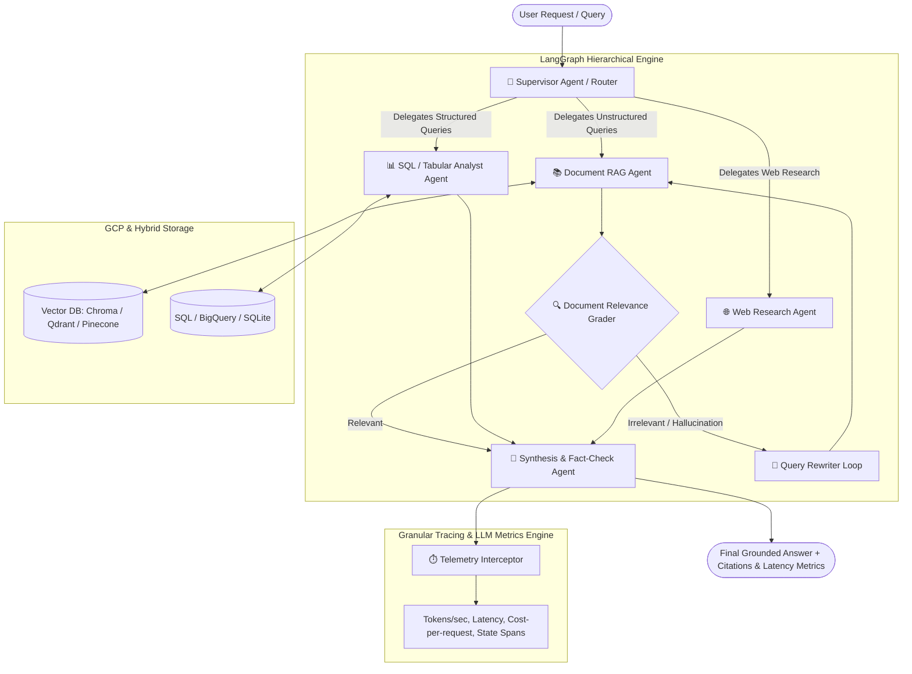

# 🏗️ Enterprise Hierarchical Multi-Agent RAG System

## 🎯 Architecture Blueprint

---

## 🛠️ Tech Stack & Job Description Mapping

| Requirement from JD | Our Implementation |
|---|---|
| **Python & DSA** | Clean modular Python 3.13, typed dataclasses, state machines |
| **Multi-Agent Systems** | **LangGraph** (StateGraph, conditional edges, supervisor router) |
| **Patterns** | **ReAct loops**, **Self-Reflection** (relevance grader & query rewriter) |
| **Vector DB + RAG** | **ChromaDB / FAISS** (local) + optional Pinecone/GCP Vertex Vector Search |
| **Structured + Unstructured** | Tabular DB (SQLite / BigQuery mock) + Unstructured Document Vector Store |
| **LLM Metrics & Tracing** | Built-in telemetry: `tokens/sec`, `cost-per-request`, step-by-step state span tracking |
| **Cloud Ready (GCP)** | Designed to deploy as a containerized **FastAPI** service to **GCP Cloud Run** |

---

## 📂 Implementation Roadmap
1. **Core Telemetry & Metrics Tracker** (tokens/sec, cost estimation, execution timer)
2. **Hybrid Storage Engine** (Document Vector Store + Structured SQL Database)
3. **LangGraph Hierarchical Workflow** (Supervisor Agent, Document RAG Agent with self-correction, SQL Agent, Synthesis Agent)
4. **FastAPI Backend + Interactive Playground UI**
5. **GCP Deployment Manifests** (Dockerfile, cloudbuild.yaml)
